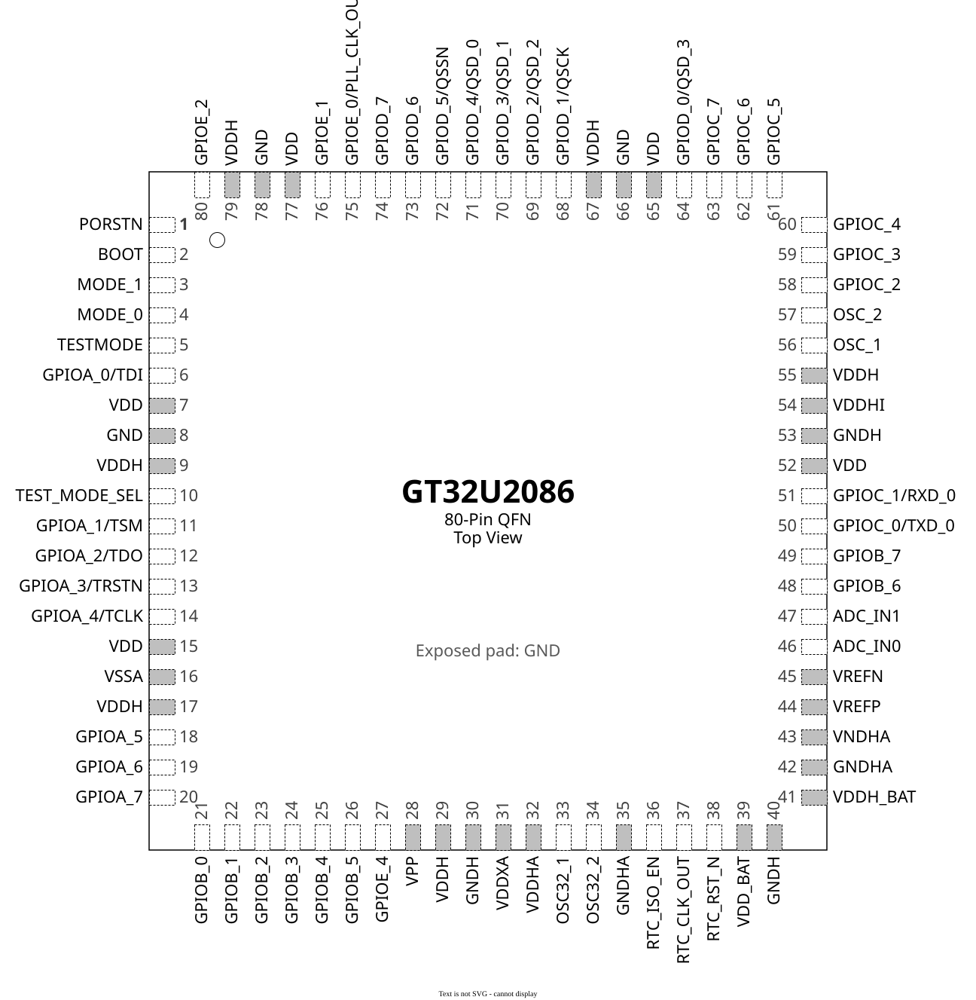

# GT32U2086 – Pinout 80-pin QFN

**Sửa sơ đồ trực tiếp bằng draw.io (mở bằng Chrome):**
https://app.diagrams.net/#Hhongvan9662-art%2Fgt32u2086-pinout%2Fmain%2FGT32U2086_pinout.drawio.svg

File sơ đồ: **`GT32U2086_pinout.drawio.svg`** – GitHub hiện thẳng thành hình, và vẫn mở ra sửa được bằng draw.io.

## Quy ước bản vẽ

- Package QFN (chân chìm): pad vẽ **bên trong viền** package, **nét đứt** – Top View.
- Chân nguồn / đất tô xám.
- Font: **Aptos Display**. Máy chưa có font này sẽ hiện font thay thế → cài bản miễn phí của Microsoft: <https://www.microsoft.com/en-us/download/details.aspx?id=106087>
- File chia 4 layer: `Package`, `Pads`, `Pin numbers`, `Pin names`. Mở bảng Layers bằng **Ctrl+Shift+L**; khoá layer không sửa để tránh kéo nhầm.
- ID từng ô đặt theo số chân: `pad-12`, `num-12`, `name-12`.

## Cách sửa

**Cách 1 – draw.io trên trình duyệt (khuyên dùng)**

1. Mở link ở đầu trang bằng **Chrome**. Lần đầu draw.io xin quyền truy cập GitHub → bấm **Authorize**.
2. Sửa trực tiếp trên sơ đồ.
3. Bấm **Ctrl+S** → ghi ngắn gọn đã sửa gì → draw.io lưu thẳng lên GitHub.

Chỉ người được mời vào Collaborators mới lưu được. Nếu báo lỗi "Dịch vụ không khả dụng hay đã bị khóa": tắt chặn quảng cáo cho app.diagrams.net, hoặc chuyển sang Chrome.

**Cách 2 – github.dev (sửa ngay trên GitHub)**

1. Mở trang repo này, bấm phím **`.`** (dấu chấm) → trang soạn thảo **github.dev** mở ra.
2. Lần đầu: bấm biểu tượng **Extensions** (4 ô vuông, cột trái) → tìm **Draw.io Integration** (Henning Dieterichs) → **Install**.
3. Bấm vào file `GT32U2086_pinout.drawio.svg` → sơ đồ mở ra để sửa như draw.io.
4. Sửa xong: bấm biểu tượng **Source Control** (cột trái) → ghi ngắn gọn đã sửa gì → **Commit & Push**.

**Cách 3 – tải về:** tải file → mở bằng draw.io (app.diagrams.net → mở từ máy, hoặc draw.io Desktop) → sửa → lưu lại đúng định dạng `.drawio.svg` → lên repo bấm **Add file › Upload files** để up đè.

## Khi nhiều người cùng sửa

- Mỗi lúc chỉ một người sửa – báo nhóm trước khi mở file, sửa xong lưu ngay.
- Xem ai sửa gì: mở file trên GitHub → **History**.
