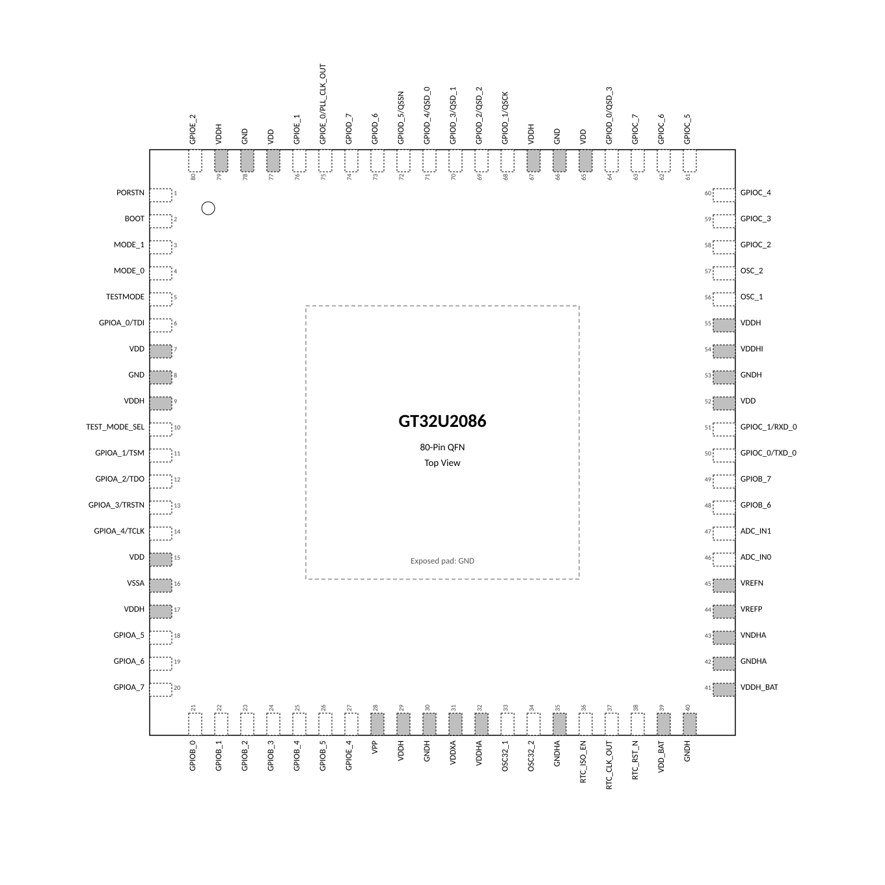

# GT32U2086 – Pinout 80-pin QFN

File gốc: **`GT32U2086_pinout.drawio`** (draw.io, lưu dạng XML không nén nên GitHub hiển thị được từng thay đổi).

## Quy ước bản vẽ

- Package QFN (chân chìm): pad vẽ **bên trong viền** package, **nét đứt** – Top View.
- Chân nguồn / đất tô xám.
- Font: **Aptos Display**. Máy chưa có font này sẽ hiển thị font thay thế → cài bản miễn phí của Microsoft: <https://www.microsoft.com/en-us/download/details.aspx?id=106087>
- File chia 4 layer: `Package`, `Pads`, `Pin numbers`, `Pin names`. Mở bảng Layers bằng **Ctrl+Shift+L**; khoá các layer không sửa để tránh kéo nhầm.
- ID từng ô đặt theo số chân: `pad-12`, `num-12`, `name-12` (dễ tìm khi xem lịch sử thay đổi).

## Cách sửa

**Cách 1 – Trên trình duyệt, không cần cài gì**

1. Mở <https://app.diagrams.net/?mode=github>
2. Chọn **Open Existing Diagram** → lần đầu bấm **Authorize** để cho draw.io truy cập GitHub.
3. Chọn repo `gt32u2086-pinout` → nhánh `main` → file `GT32U2086_pinout.drawio`.
4. Sửa xong bấm **Ctrl+S**, ghi ngắn gọn đã sửa gì → draw.io lưu thẳng vào GitHub.

Link mở nhanh: [Sửa trong draw.io](https://app.diagrams.net/#HYOUR-GITHUB-NAME/gt32u2086-pinout/main/GT32U2086_pinout.drawio)

**Cách 2 – draw.io Desktop**: tải file về, sửa, rồi lên repo bấm **Add file › Upload files** để up đè.

## Khi nhiều người cùng sửa

- Mỗi lúc chỉ một người sửa – báo nhóm trước khi mở file, sửa xong lưu ngay.
- Sau khi sửa, cập nhật ảnh `preview.png`: **File › Export as › PNG** (nền trắng, zoom 100%) rồi up đè.
- Xem ai sửa gì: mở file trên GitHub → **History**.
